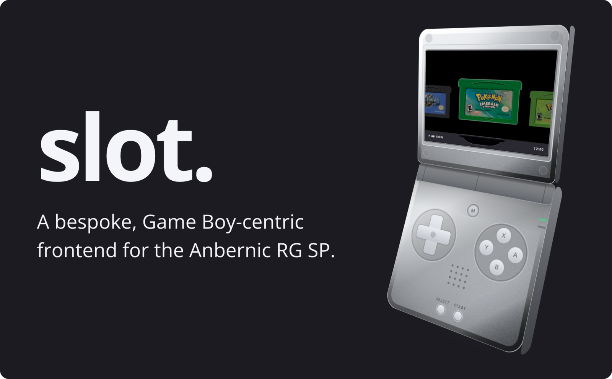
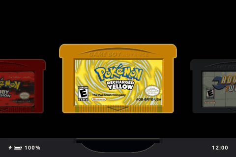
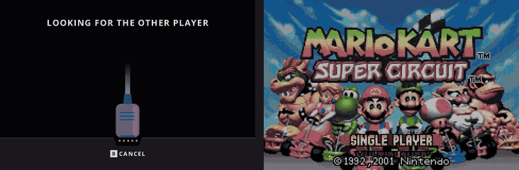

# slot for Android

A dedicated mobile port bringing the author's [slot](https://github.com/BrandonKowalski/slot) launcher to Android smartphones and foldable hardware.

> [!IMPORTANT]
> **Independent Downstream Port:** This release is an unofficial, standalone fork with no direct connection to or endorsement from the author. Upstream `slot` was created intentionally for dedicated Linux handhelds; this build adapts that experience specifically for touch and mobile devices.
>
> **Support & Bug Reports:** Please do not file tickets or open discussions regarding this Android build on upstream `slot`'s issue tracker. All mobile-specific bugs, feedback, and crashes must be reported directly on this repository.

> [!NOTE]
> This repository houses the Android port of `slot`. While the shelf layouts, aesthetic, and emulation cores stem from the author's original release, this build introduces on-screen input, native Android storage handling, and foldable display awareness. Detailed installation procedures, configuration guides, and build scripts are documented in [ANDROID.md](ANDROID.md).  
> *Crafted in Brunei Darussalam by a cat with pink headphones.*

> [!WARNING]
> **Uncompressed Media Required:** Game files must be extracted beforehand. The launcher does not parse archive formats like `.zip` or `.7z`.

* Upstream usage manual: [slot-cfw.fyi](https://slot-cfw.fyi)
* Project release notes: [CHANGELOG.md](CHANGELOG.md)

---

## Overview

Upstream `slot` is a purpose-built frontend designed to emulate the tactile nostalgia of the Game Boy Advance SP on portable Linux handhelds, providing dedicated shelves and emulator workflows strictly for Game Boy (GB), Game Boy Color (GBC), and Game Boy Advance (GBA) titles.

---

## What This Fork Changes

This release maintains the core identity of `slot`—its signature 3D cart animations, carousel shelves, game saves, and emulator backend—while modernizing the stack for touch-first smartphone environments.

| Component | Upstream (The Author) | Android Port |
|---|---|---|
| **Community Upgrades** | Not included | Integrates retro color profiles, display blending, cheat management, RetroAchievements support, and LaunchBox box art (adapted from implementations by pvaibhav and RetroGame66, rebuilt natively for `slot`'s layout) |
| **Controls & Input** | Physical handheld buttons | Fully configurable on-screen touch overlay (D-pad, A/B/X/Y, L/L2/R/R2, Select, Start, and Menu with scale and transparency sliders), plus external controller and keyboard mapping. Supports L2 rewinding and lockable R2 fast-forwarding (double-tap to hold) |
| **Cartridge Theming** | Populated via desktop Cart Studio files | On-device Cart Editor: customize shell plastics, finish textures, borders, custom typography, or import photos straight from your device gallery (with a quick-reset toggle to return to defaults) |
| **Tactile Feedback** | Internal handheld motor rumble | Mobile vibration support for both UI touch haptics and in-game force feedback, complete with adjustable intensity |
| **Link Play** | Hardware link cables and local Wi-Fi | Omitted for now; a mobile-compatible Wi-Fi link system is in development |
| **Excluded Features** | Hardware status LEDs, clamshell physical lid detection, and handheld standby hooks | Replaced with standard mobile operating system lifecycle and window handling |
| **Target Platform** | Specialized Linux handhelds (framebuffer output) | 64-bit Android (`arm64`), featuring smooth real-time fold and unfold layout transitions |
| **Storage Architecture** | MicroSD card directories | Accessible via `/sdcard/slot/`, paired with a dedicated Library interface to manage exports, restorations, and direct ROM imports from your Downloads folder |

For complete implementation notes, dependency setups, and technical credits, check [ANDROID.md](ANDROID.md). A comprehensive breakdown of updates is tracked in [CHANGELOG.md](CHANGELOG.md).

---

## Interface Preview

---

## Device Compatibility

This mobile build targets 64-bit ARM (`arm64`) Android smartphones and foldables (actively validated on a Samsung Galaxy Z Fold 7 since version 1.0.0).

If you test this Android release on unlisted hardware or different aspect ratios, please open an issue on GitHub to share your results.

---

## AI Transparency Statement

### Upstream Project
The primary Rust frontend was created with assistance from Claude Opus, with every line reviewed and maintained by the author. Upstream documentation was hand-crafted. The project was built as a passion project to relive the feel of the GBA SP, offered freely to the community.

### Android Port
The Android translation was developed with assistance from Anthropic's Claude (via Claude Code), which helped author the Android runtime wrapper, on-screen controls, Cart Editor UI, Library file system hooks, package setup, and mobile documentation (`ANDROID.md` and `CHANGELOG.md`). Architecture choices, on-device validation (tested on hardware using a Galaxy Z Fold 7), and release decisions were driven manually. Unlike the upstream documentation, the accompanying Android markdown files were drafted with AI assistance.

---

## Acknowledgments

The design, interactive cartridge concepts, and foundational architecture originate entirely from the original author's [slot](https://github.com/BrandonKowalski/slot). If you enjoy this project, make sure to visit the author's repository and leave a star.
